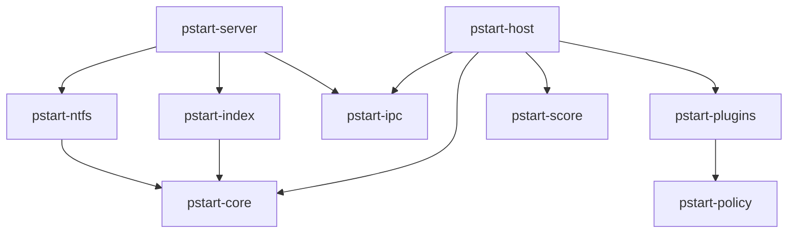

# pSTART v0.1

Windows 原生文件启动器。Rust workspace，SQLite 索引 + NTFS 变更日志 + AF_UNIX IPC + 无边框 GDI 覆盖层。

## 构建

Windows，Rust 1.85+。仓库内 `rust-toolchain.toml` 固定 `1.99.1`，并安装 `rustfmt`、`clippy`。

```powershell
cargo build --release
```

产物：

```text
target/release/pstart-server.exe
target/release/pstart-host.exe
```

质量门禁：

```powershell
cargo fmt --all -- --check
cargo clippy --all-targets -- -D warnings
cargo test
cargo test --release
cargo doc --no-deps
```

`Cargo.toml` 的 release profile 使用 LTO、`codegen-units=1`、strip 与 `panic=abort`。

## 架构

| 组件 | 职责 |
|---|---|
| `pstart-core` | 公共 ID、限制、路径谓词、稳定错误类别 |
| `pstart-ipc` | 帧编码、消息、AF_UNIX 会话 |
| `pstart-index` | SQLite/内存索引、USN 增量、查询候选 |
| `pstart-ntfs` | NTFS USN/MFT 解析 |
| `pstart-score` | 名称匹配评分与排序 |
| `pstart-policy` | 插件 capability 与路径授权 |
| `pstart-plugins` | Wasmtime component 运行时 |
| `pstart-server` | Windows 服务、索引循环、IPC 服务端 |
| `pstart-host` | 覆盖窗、输入、结果列表、查询客户端 |



`pstart-server install` 注册 Windows 服务；`console` 在当前终端运行，`uninstall` 删除服务。安装/卸载需要管理员权限。

默认数据目录：

```text
C:\ProgramData\pSTART\
  index.db
  ipc\pstart.sock
  bin\
```

默认索引根为 `C:\`。

## 使用

启动 `pstart-host.exe` 后：

- 双击 `Ctrl` 显示/隐藏覆盖窗
- 输入即搜索，结果固定 9 行
- `Up` / `Down`、`PageUp` / `PageDown`、滚轮整页切换
- `Enter` 打开选中项
- `Delete` 删除选中历史项
- `Esc` 先取消在途查询，否则隐藏并恢复原前台窗口
- 空闲超时自动隐藏
- 输入框右侧灰字显示结果数

窗口和输入框使用屏幕宽高的黄金比例定位；输入框文字垂直居中。

## 命令

以 `/` 开头执行管理命令：

```text
/backup <path>
/backup-delete <path>
/restore <path>
/allow <path>
/allow-clear
/action <path>
/copy <text>
/open <path>
/alias <name> <target>
/plugins
/config
/settings
```

普通表达式会在结果区显示计算结果。

## 配置

服务端环境变量：

| 变量 | 默认 | 作用 |
|---|---|---|
| `PSTART_DATA_DIR` | `C:\ProgramData\pSTART` | 数据目录 |
| `PSTART_ROOT` | `C:\` | NTFS 索引根 |
| `PSTART_POLL_MS` | `500` | USN 轮询间隔 |
| `PSTART_MAX_CONNECTIONS` | `16` | 最大 IPC 连接数 |
| `PSTART_QUERY_LIMIT` | `200` | 单连接每秒查询上限 |
| `PSTART_GLOBAL_QUERY_LIMIT` | `800` | 全局每秒查询上限 |

Host 环境变量：

| 变量 | 作用 |
|---|---|
| `PSTART_SOCKET` | 覆盖 IPC socket 路径 |
| `PSTART_HOST_DB` | 覆盖 host 历史数据库 |
| `PSTART_APP_SEARCH=0` | 禁用应用搜索 |
| `PSTART_APP_PLUGIN` | 指定应用搜索 WASM 插件 |
| `PSTART_SKIN` | 指定皮肤 TOML |
| `PSTART_VALIDATE_PATHS=1` | 打开结果路径校验 |
| `PSTART_OPEN_DRY_RUN` | 打开动作只演练不执行 |
| `PSTART_FORCE_DPI` | 强制 DPI |
| `PSTART_SYNC_PAINT` | 首帧同步绘制 |

## 插件

`wit/plugin.wit` 定义 WASM component ABI：

```wit
world plugin {
  import host-record, host-config, host-search
  import host-app-search, host-open, host-copy
  export manifest, run, run-string
}
```

`pstart-plugins` 使用 Wasmtime component model 加载；打开、复制、搜索等 host 能力受 `pstart-policy` capability 和 `/allow` 根路径限制。

## 性能

当前 UI 路径针对真实输入做了以下约束：

- 可见行文本缓存，滚动时只重绘选中行
- 结果导航按整页，不逐行重排
- 脏区域 BitBlt，不整窗刷新
- 输入、历史、查询在 host 线程与持久 worker 之间分离
- 默认不同步首帧；`PSTART_SYNC_PAINT` 仅用于对照

仓库不附带可发布的基准数据；性能数字取决于 NTFS 规模、CPU、磁盘缓存和查询分布，复测需在本机 release 构建上执行。

## 范围

- Windows x64
- NTFS 索引
- 默认索引 `C:\`，根可配置
- SQLite 数据库
- 可选 WASM component 插件
- 不带安装包生成脚本；发布包需另行构建

## 许可

MIT，见 [LICENSE](LICENSE)。

`plugins/action.wasm` 是可选动作插件；`wit/plugin.wit` 是公开插件 ABI。
